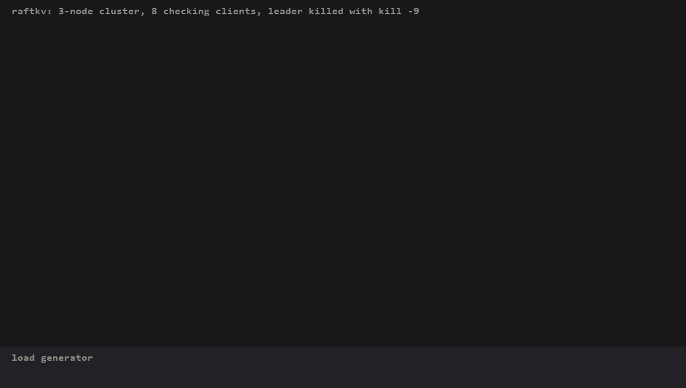
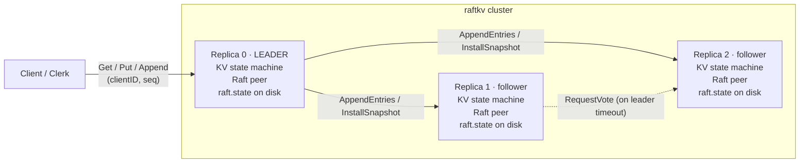
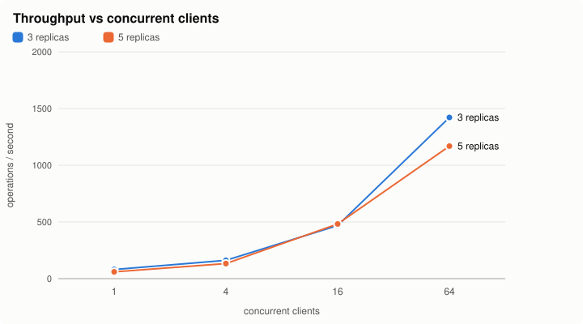
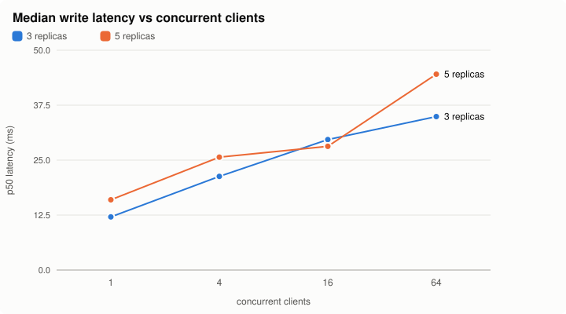
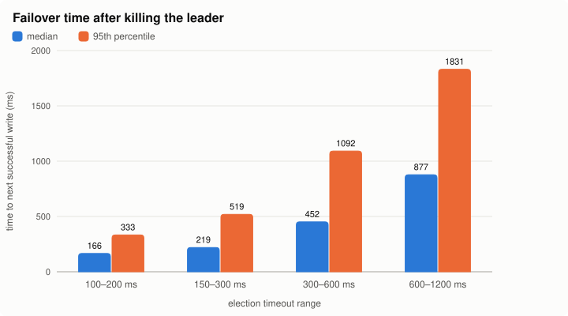
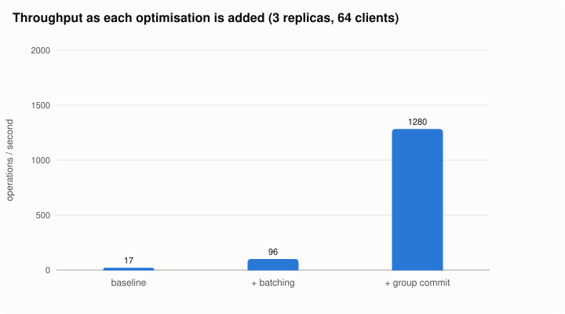

# raftkv

[](https://github.com/Navneesh004/raftkv/actions/workflows/ci.yml)

A fault-tolerant, **linearizable key-value store** built on my own from-scratch
implementation of the **Raft consensus algorithm** in Go. No Raft or RPC
framework is used. The repo includes a fault-injecting simulated network, a
Porcupine linearizability checker, crash-safe on-disk persistence, a
Docker Compose cluster and a `kill -9` chaos script.

**Highlights**

- **Raft, all of it:** leader election, log replication, the commitment rule
  that handles the Figure 8 case, persistence, fast log backtracking, and
  snapshots / log compaction with `InstallSnapshot`.
- **Exactly-once client semantics:** client IDs plus sequence numbers make a
  retried `Append` apply once, even across crashes, because the duplicate table
  is part of the snapshot.
- **Verified, not just tested:** every randomized chaos test records the full
  client history and checks it for **linearizability with
  [Porcupine](https://github.com/anishathalye/porcupine)**. Every test runs
  under Go's race detector.
- **Real deployment:** separate processes over TCP, state on disk with
  `write → fsync → rename → fsync(dir)`, a 3- or 5-node Docker Compose
  cluster, and a chaos script that `kill -9`s random replicas while a client
  keeps writing and checking every read.
- **Measured:** throughput and latency for 3 vs 5 nodes, failover time against
  the election timeout, and before/after numbers for batching and group commit
  ([results](#results)).



*Recorded run: 3 nodes, 8 checking clients. The leader is `kill -9`ed, node1 wins
the election, node2 restarts from its on-disk log and catches up. 2869 operations,
longest gap with no successful operation 1.75 s, 0 wrong reads.*

## Architecture



**One write, step by step:**

1. The clerk sends `Append(k, v, clientID, seq)` to the server it believes is
   leader. Followers answer `ErrWrongLeader` with a hint, and the clerk retries
   elsewhere.
2. The leader calls `raft.Start(op)`. The op is appended to its log and
   persisted, and every follower's replicator wakes up immediately.
3. Each follower checks that its log matches at `PrevLogIndex/PrevLogTerm`,
   appends the entries, fsyncs, and replies.
4. Once a majority has stored the entry, and the entry is from the leader's
   current term, the leader advances `commitIndex`.
5. Every replica's applier feeds committed entries to the KV state machine in
   log order, skipping `(clientID, seq)` pairs it has already applied.
6. The leader's RPC handler, which was waiting on that log index, replies to
   the client. If a different op landed at that index, leadership was lost and
   the client retries.

`Get` also goes through the log, so a leader that has been deposed without
knowing it can never serve a stale read.

## Repository layout

| Path | What it is |
|---|---|
| [`raft/`](raft) | The consensus algorithm, split by concern: [`election.go`](raft/election.go), [`replication.go`](raft/replication.go), [`snapshot.go`](raft/snapshot.go), [`persist.go`](raft/persist.go) |
| [`kv/`](kv) | KV server and client (clerk) with duplicate detection; [`kv/history`](kv/history) is the Porcupine model |
| [`network/`](network) | In-process simulated network for tests: drop, delay, reorder, partition, crash |
| [`transport/`](transport) | TCP transport (net/rpc + gob) with timeouts and reconnects |
| [`node/`](node) | Assembles one deployable replica (KV + Raft + disk + TCP) |
| [`cmd/`](cmd) | `raftkv-server`, `raftkv-cli`, `raftkv-loadgen` (checking load generator), `raftkv-bench` |
| [`deploy/`](deploy) | Docker Compose for 3 and 5 nodes, and [`chaos.sh`](deploy/chaos.sh) |
| [`bench/results/`](bench/results) | Benchmark CSVs, charts and [summary](bench/results/summary.md) |

## Quick start

**Requirements:** Go 1.23+ and Docker. No local Go? Every Go command also
works through Docker with `.\scripts\go-docker.ps1 <args>` on Windows.

```bash
# run the full test suite with the race detector
go test -race ./...

# start a 3-node cluster
docker compose -f deploy/docker-compose.yml up -d --build
docker compose -f deploy/docker-compose.yml run --rm cli put greeting hello
docker compose -f deploy/docker-compose.yml run --rm cli get greeting
docker compose -f deploy/docker-compose.yml run --rm cli status

# watch elections happen live, then kill the leader in another terminal
docker compose -f deploy/docker-compose.yml logs -f node0 node1 node2
docker compose -f deploy/docker-compose.yml kill -s SIGKILL node0

# chaos: random kill -9 every few seconds for an hour while 8 clients check every read
./deploy/chaos.sh 3600 8

# benchmarks (writes CSV + SVG charts to bench/results)
go run ./cmd/raftkv-bench -mode all
```

`cli status` prints every replica's role, term, commit index and log range.
Each replica also serves JSON at `http://localhost:1808N/status`.

## Testing

The test suite is the core of the project. Raft code that only works when the
network behaves is easy to write; the tests exist to break it.

**The simulated network** ([`network/`](network)) runs every node inside the
test binary and routes each RPC through a fault injector. It can drop 10% of
requests and replies, delay messages by up to 27 ms (which reorders them),
partition the cluster into groups, disconnect single nodes, make calls to dead
nodes hang for up to 2 s, and crash a node so its in-flight replies are lost.
Arguments are gob-encoded like a real wire, so no test can accidentally share
memory between nodes.

**The checker** watches every node's apply channel and fails the test the
moment two nodes apply different commands at the same index.

| Area | Tests | What they prove |
|---|---|---|
| Election | `TestElection*` | one leader at startup; re-election when the leader disconnects; **never two leaders in one term** (sampled continuously under shifting partitions on a lossy network); **a minority partition never elects a leader** |
| Replication | `TestAgree*` | agreement under normal load; a follower that drops out catches up; **nothing commits without a majority**; **a partitioned leader's uncommitted entries are overwritten** when it rejoins; fast catch-up of long divergent logs; RPC-count bounds (no heartbeat storms) |
| Persistence | `TestPersist*`, `TestFilePersister*` | whole-cluster crash and restart; repeated crashes including the leader; **Figure 8** with crashes and with lossy partitions; churn where every acknowledged value must survive; torn writes and bit flips in the state file are detected |
| Snapshots | `TestSnapshot*` | log compaction keeps state bounded; lagging and crashed followers catch up via `InstallSnapshot`, on reliable and lossy networks |
| KV service | `TestKV*` | basic ops; **retried requests apply exactly once, across crashes**; a minority leader can't serve reads or writes; latency < 25 ms per op; randomized workloads with partitions, crashes, packet loss and snapshots, **checked by Porcupine for linearizability** |
| End to end | `TestClusterOverTCP` | real TCP + real files: leader crash, recovery from disk, full-cluster restart with no data loss |

Every randomized KV workload runs two independent correctness checks:

1. **Own-key check.** Each client appends unique tokens to its own key and
   reads it back. The value must be exactly that client's acknowledged appends,
   in order, each exactly once. This catches lost writes, duplicates,
   reordering and stale reads.
2. **Linearizability.** Every operation on shared keys is recorded with
   real-time call and return timestamps, and Porcupine searches for a
   sequential order that respects real time and explains every result. If none
   exists, the test fails and writes an interactive HTML visualization of the
   violating history.

Because Raft bugs are timing-dependent, the CI `stress` job repeats the
election and agreement tests 20 times with `-race`, and `make stress` runs
every Raft test 50 times.

**Current status:** all 40 tests pass with `-race` (two consecutive full runs),
the election and agreement tests pass 10 out of 10 repetitions with `-race`,
and every randomized KV history checked by Porcupine is linearizable. The
largest single history is about 2,500 operations, recorded under crashes and
restarts.

## Results

All numbers come from `go run ./cmd/raftkv-bench -mode all` (raw CSVs and the
generated summary are in [`bench/results/`](bench/results)). Replicas run as
separate servers in one process, talking over loopback TCP and **fsyncing to
disk on every persist**. This is a Docker container on a Windows laptop, so
treat absolute numbers as indicative: fsync latency dominates, and it varies
from run to run.

### Chaos test (Docker, `kill -9`)

`./deploy/chaos.sh 120 8`: 3 replicas in Docker, 8 checking clients, and a
random replica `kill -9`ed every few seconds and restarted from its volume.

> **11 kills in 2 minutes, 25,606 checked operations, 0 wrong reads.** The
> longest stretch with no successful operation was 1.9 s, and snapshots kept
> each replica's log under about 160 entries.

To run it for an hour, the way the project plan specifies, use
`./deploy/chaos.sh 3600 8`.

### Throughput and latency: 3 vs 5 replicas




| clients | 3 replicas | 5 replicas |
|---|---|---|
| 1 | 81 ops/s · p50 12.1 ms | 60 ops/s · p50 16.0 ms |
| 16 | 469 ops/s · p50 29.7 ms | 482 ops/s · p50 28.1 ms |
| 64 | **1,422 ops/s** · p50 34.9 ms | 1,169 ops/s · p50 44.5 ms |

With one client, a write costs about two fsyncs plus a round trip. Adding
clients raises throughput almost linearly, because group commit and batching
let many requests share one fsync and one RPC. Five replicas are slower at
high load: each write has to wait for 3 acknowledgements instead of 2, and the
leader sends 4 copies instead of 2.

### Failover vs election timeout



| election timeout | median failover | p95 | unneeded elections in 10 s of load |
|---|---|---|---|
| 100–200 ms | **166 ms** | 333 ms | 0 |
| 150–300 ms | 219 ms | 519 ms | 0 |
| 300–600 ms (default) | 452 ms | 1,092 ms | 1 |
| 600–1200 ms | 877 ms | 1,831 ms | 0 |

Each setting kills the leader 50 times; failover is the time until a client's
next write succeeds. Failover tracks the election timeout almost exactly:
detection time dominates, and the election itself takes one round trip. The
one unneeded election (a follower timing out while the leader was alive,
probably during a disk or GC stall) is the false-alarm side of the
[trade-off below](#failure-detection-flp-and-the-timeout-trade-off). On a
quiet LAN a short timeout is affordable; across a WAN or with slow disks it
is not.

### Optimisations: batching and group commit



| configuration (3 replicas, 64 clients) | ops/s | p50 |
|---|---|---|
| baseline: 1 entry per AppendEntries, leader fsyncs each entry under the lock | 17 | 3.3 s |
| + batching | 96 | 517 ms |
| + group commit | **1,280** | 36 ms |

Batching alone helps followers, which now pay one fsync per batch, but the
leader still serializes every client on its own fsync. Group commit removes
that bottleneck. Across runs on this machine, the combination gave **20–70×**
the baseline throughput; the baseline is the noisiest number, because it is
pure fsync queueing.

## Design notes and bugs avoided

These are the classic Raft mistakes, and where this code guards against each:

1. **Resetting the election timer too often.** The timer is reset only on an
   `AppendEntries` from the current leader, on granting a vote, or on starting
   an election ([`election.go`](raft/election.go)). Resetting it on every
   message would let a dead leader go unnoticed.
2. **Holding the lock during an RPC.** Every RPC follows the same pattern: lock,
   copy what's needed, unlock, call, re-lock, and re-check. Holding a lock
   across a call lets two nodes deadlock waiting on each other.
3. **Trusting stale replies.** After every reply the code checks that the term
   and role haven't changed since the request was sent. `matchIndex` never
   moves backwards, and a reordered rejection can't undo progress.
4. **Ignoring a higher term.** Any request or reply carrying a higher term
   makes the node adopt that term and step down immediately.
5. **Committing old-term entries by counting replicas (Figure 8).**
   `advanceCommitLocked` only counts replicas of entries from the *current*
   term. Older entries commit indirectly
   ([`replication.go`](raft/replication.go)). `TestPersistFigure8*` builds the
   exact scenario hundreds of times.
6. **Truncating the log on a delayed AppendEntries.** The follower truncates
   only at the first real conflict. A reordered, shorter AppendEntries must
   never chop off entries that a newer one already added.
7. **Torn writes.** State is written to a temp file, fsynced, renamed over the
   old file, and then the directory is fsynced. A CRC detects anything else.
   Term, vote and log are persisted *before* the RPC reply is sent.

Other decisions:

- **One replicator goroutine per follower, one RPC in flight at a time.**
  Entries that arrive while an RPC is in flight go out together in the next
  one. This is natural batching that needs no tuning, and it is what the
  batching benchmark measures.
- **Group commit on the leader.** `Start()` appends in memory and returns. A
  syncer goroutine encodes the state under the lock, fsyncs it *outside* the
  lock, and then marks those entries durable. Every request that arrived
  during one fsync shares the next one. The leader counts itself toward a
  majority only for entries already on disk, and each save carries a version
  number, so a slow syncer write can never overwrite a newer term or vote.
  Together with batching, this makes writes about 20× faster
  ([results](#results)).
- **Fast backup.** A rejecting follower returns `ConflictTerm` and
  `ConflictIndex`, so the leader skips a whole term per round trip instead of
  one entry.
- **Snapshots** keep the log, and so each persist, bounded (the default
  threshold is 64 KB). Raft state is persisted as one atomically replaced
  file, which is simple and obviously correct. An append-only write-ahead log
  would make each persist O(new entries) instead of O(state). That is the next
  step for larger states.

## Failure detection, FLP and the timeout trade-off

Raft's election timeout is a **failure detector**: a follower *suspects* the
leader is dead because it has been silent for too long. That suspicion can be
wrong, because a slow leader looks exactly like a dead one. Raft makes this
safe with terms. If a wrongly suspected leader comes back, its messages carry
an old term, everyone rejects them, and it steps down.

This is how Raft handles the **FLP impossibility result**: in a fully
asynchronous network, no deterministic algorithm can guarantee consensus if
even one node may crash. Raft uses timing **only for liveness (making
progress), never for safety**. A badly tuned timeout can slow the cluster down
with extra elections, but it can never make two replicas disagree.

The failover chart above shows the trade-off. A short timeout detects a crash
quickly but risks false alarms, meaning needless elections when a heartbeat is
merely late. A long timeout is stable but slow to react. The two properties of
a failure detector are **completeness** (every crash is eventually suspected)
and **accuracy** (live nodes aren't wrongly suspected). A fixed timeout trades
one against the other. Adaptive detectors such as the **φ accrual detector**
used by Cassandra and Akka learn the distribution of heartbeat arrival times
and output a suspicion level instead of a yes/no answer.

## References

- Diego Ongaro and John Ousterhout, *In Search of an Understandable Consensus
  Algorithm (Extended Version)*: Figure 2 is the spec this code follows.
- The Raft website and visualization: <https://raft.github.io>
- Jon Gjengset, *Students' Guide to Raft*
- Anish Athalye, *Porcupine: a fast linearizability checker*

## License

MIT
