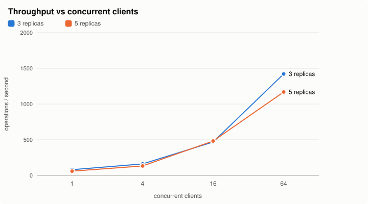
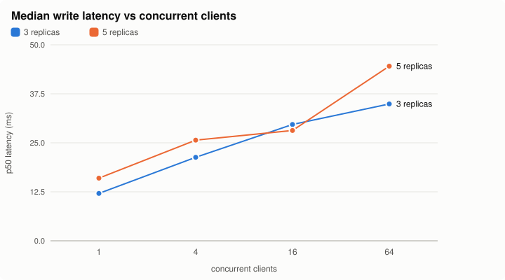
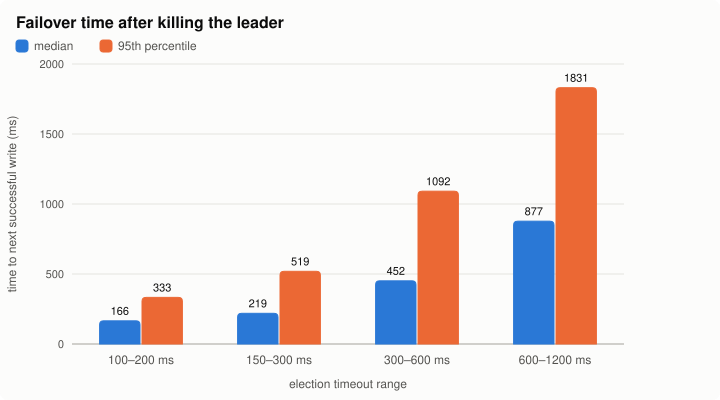
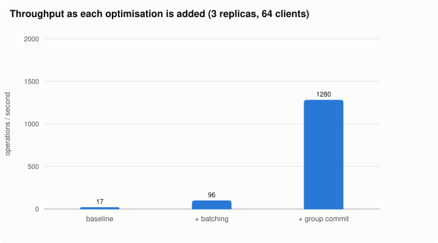

# Benchmark results

Generated by `raftkv-bench` on 2026-11-25. fsync: true. Replicas run in one process over loopback TCP with on-disk state.

## Throughput and latency: 3 vs 5 replicas

| replicas | clients | ops/s | p50 latency | p99 latency |
|---|---|---|---|---|
| 3 | 1 | 81 | 12.09 ms | 20.62 ms |
| 3 | 4 | 162 | 21.31 ms | 45.60 ms |
| 3 | 16 | 469 | 29.69 ms | 72.77 ms |
| 3 | 64 | 1422 | 34.91 ms | 76.65 ms |
| 5 | 1 | 60 | 15.99 ms | 36.33 ms |
| 5 | 4 | 133 | 25.68 ms | 58.81 ms |
| 5 | 16 | 482 | 28.15 ms | 86.97 ms |
| 5 | 64 | 1169 | 44.55 ms | 160.61 ms |

## Leader failover vs election timeout

The leader is killed (connections dropped, process state gone) 50 times per setting; failover is the time until a client's next write succeeds. Heartbeats are every 50 ms in every setting. *Unneeded elections* counts term changes during 10 s of steady load with no failures — false alarms by the failure detector.

| election timeout | median failover | p95 | max | unneeded elections / 10 s |
|---|---|---|---|---|
| 100–200 ms | 166 ms | 333 ms | 676 ms | 0 |
| 150–300 ms | 219 ms | 519 ms | 624 ms | 0 |
| 300–600 ms | 452 ms | 1092 ms | 3832 ms | 1 |
| 600–1200 ms | 877 ms | 1831 ms | 1900 ms | 0 |

## Optimisations: batching and group commit

3 replicas, 64 clients, applied one at a time:

- **baseline**: each AppendEntries carries one entry, and the leader fsyncs every entry inside `Start()` while holding the lock.
- **+ batching**: every entry that arrived while the previous AppendEntries was in flight goes in the next one, so followers pay one fsync per batch.
- **+ group commit**: the leader also stops fsyncing inside `Start()`; a syncer goroutine fsyncs all entries appended since its last write in one go, outside the lock, and the leader counts itself toward a majority only for entries already on disk.

| configuration | ops/s | p50 latency | p99 latency |
|---|---|---|---|
| baseline | 17 | 3335.31 ms | 4835.14 ms |
| + batching | 96 | 517.43 ms | 3155.16 ms |
| + group commit | 1280 | 36.13 ms | 829.95 ms |

Together, the two optimisations raise throughput **73.5×** over the baseline.

